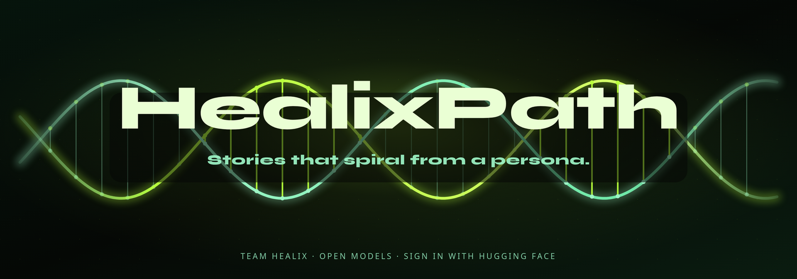

<div align="center">



</div>

<p align="center">
  <a href="https://huggingface.co/spaces/mackenzietechdocs/HealixPath"></a>
  <a href="https://huggingface.co/spaces/MCP-1st-Birthday/TeamHealix"></a>
  <a href="https://huggingface.co/collections/mackenzietechdocs/healixpath"></a>
  <a href="https://mso-docs.github.io/HealixPath/"></a>
  <a href="https://github.com/mso-docs/HealixPath"></a>
  <a href="https://youtu.be/zz5AliukXKk"></a>
  <a href="#sign-in-with-hugging-face-free-ai-no-api-key"></a>
  
</p>

# HealixPath

**Stories that spiral from a persona.** HealixPath is an AI-powered storytelling engine that turns a product, a problem, or a journey stage into structured, realistic narratives for the people who will actually use the work.

Built by **Mackenzie O'Brien** ([@mackenzietechdocs](https://huggingface.co/mackenzietechdocs), [GitHub](https://github.com/mso-docs)) and **co-author @DevRubenArevalo** ([Hugging Face](https://huggingface.co/DevRubenArevalo), [GitHub](https://github.com/DevRubenArevalo)). Together we are Team Healix.

The official November 2025 hackathon submission lives at [MCP-1st-Birthday/TeamHealix](https://huggingface.co/spaces/MCP-1st-Birthday/TeamHealix) and is kept unchanged. This repository and the live Space are the maintained copy.

| | |
| :--- | :--- |
| **Project page** | [mso-docs.github.io/HealixPath](https://mso-docs.github.io/HealixPath/) |
| **Hackathon Space (frozen)** | [MCP-1st-Birthday/TeamHealix](https://huggingface.co/spaces/MCP-1st-Birthday/TeamHealix) |
| **Live Space** | [mackenzietechdocs/HealixPath](https://huggingface.co/spaces/mackenzietechdocs/HealixPath) |
| **Collection** | [HealixPath](https://huggingface.co/collections/mackenzietechdocs/healixpath) |
| **GitHub** | [mso-docs/HealixPath](https://github.com/mso-docs/HealixPath) |
| **Demo video** | [youtu.be/zz5AliukXKk](https://youtu.be/zz5AliukXKk) |

## Sign in with Hugging Face (free AI, no API key)

This live copy does not use any paid API key. Text generation runs on open models through [Hugging Face Inference Providers](https://huggingface.co/docs/inference-providers), using **your own** Hugging Face account:

1. Click **Sign in with Hugging Face** at the top of the app and approve the `inference-api` permission.
2. Generate stories, journeys, and personas. Each request is billed to your account's free monthly Inference Providers allowance. If you run out, Hugging Face will tell you; PRO accounts get a larger allowance.
3. Signed-out visitors can browse and search personas, but generation shows a "please sign in" message. The Space never falls back to its owner's token or any secret.

Model: [`openai/gpt-oss-20b`](https://huggingface.co/openai/gpt-oss-20b) (open weights, Apache 2.0, instruction-tuned). When running your own copy, set the `HEALIXPATH_MODEL` environment variable to any chat model served by Inference Providers.

**MCP clients:** the Gradio MCP endpoint is `https://mackenzietechdocs-healixpath.hf.space/gradio_api/mcp/`. Tools that generate text need a Hugging Face token with the "Make calls to Inference Providers" permission; send it as `Authorization: Bearer <your token>`.

**Running locally:** `pip install -r requirements.txt && python app.py`. Local OAuth sign-in needs a Space; the app does not read `HF_TOKEN`. Duplicate the Space to your account to get your own copy with sign-in enabled.

## Posts and video

- LinkedIn: [announcement](https://www.linkedin.com/feed/update/urn:li:activity:7401032353361477633/) and [hackathon post](https://www.linkedin.com/posts/mackenzieoc_mcp1stbirthday-hackathon-huggingface-activity-7395261430117060608-CLZA)
- Demo video: [youtu.be/zz5AliukXKk](https://youtu.be/zz5AliukXKk)

---

## 🧠 1. Product Overview (README + Pitch)

**HealixPath** delivers AI-powered persona storytelling for UX, product, and design teams. Instead of vague bullet points like “User gets frustrated during checkout,” HealixPath generates:

- actionable narratives  
- persona-grounded insights  
- pain points & opportunities  
- before/after feature impact stories  
- journey-map narratives  

Designed to help product teams feel their users, not just document them.

---

## 🛠️ 2. MCP-Compatible Tools

Each tool is exposed through the MCP server (`src/index.ts`) and powered by open models via Hugging Face Inference Providers in the Gradio app (the original hackathon build used Claude). Prompts request JSON-only output.

### 1. `list_personas`
Lists all available personas with their key attributes.

**Input**
```json
{
  "limit": "number (optional)"
}
```

**Output**
```json
{
  "personas": [
    {
      "id": "string",
      "name": "string",
      "age": "number",
      "location": "string",
      "job_title": "string",
      "industry": "string",
      "tech_literacy": "string",
      "primary_goals": ["string"],
      "pain_points": ["string"],
      "user_story": "string"
    }
  ],
  "total": "number"
}
```

### 2. `search_personas`
Search and filter personas by various criteria.

**Input**
```json
{
  "role": "string (optional)",
  "industry": "string (optional)",
  "age_range": "string (optional, e.g., '25-35')",
  "tech_literacy": "string (optional)",
  "location": "string (optional)"
}
```

**Output**
```json
{
  "personas": ["array of matching personas"],
  "count": "number",
  "filters": "object with applied filters"
}
```

### 3. `user_story`
Generates a structured narrative user story + acceptance criteria from a product and persona.

**Input**
```json
{
  "product": "string",
  "persona_id": "string (optional)",
  "persona_override": "string (optional)"
}
```

**Output**
```json
{
  "story": "string",
  "acceptance_criteria": ["string"],
  "risks": ["string"]
}
```

### 4. `customer_experience_tale`
Creates a short narrative describing a persona experiencing a specific problem.

**Input**
```json
{
  "persona_id": "string (optional)",
  "persona_override": "string (optional)",
  "problem": "string"
}
```

**Output**
```json
{
  "title": "string",
  "narrative": "string",
  "pain_points": ["string"],
  "opportunities": ["string"]
}
```

### 5. `feature_impact_story`
Shows the before and after of a persona interacting with a feature.

**Input**
```json
{
  "feature_description": "string",
  "persona_id": "string (optional)",
  "persona_override": "string (optional)"
}
```

**Output**
```json
{
  "before_story": "string",
  "after_story": "string",
  "key_benefits": ["string"],
  "success_metrics": ["string"]
}
```

### 6. `journey_map_story`
Generates a narrative for a specific stage of the user journey.

**Input**
```json
{
  "stage": "string",
  "product": "string",
  "persona_id": "string (optional)",
  "persona_override": "string (optional)"
}
```

**Output**
```json
{
  "stage": "string",
  "narrative": "string",
  "touchpoints": ["string"],
  "emotions": ["string"],
  "breakdowns": ["string"],
  "opportunities": ["string"]
}
```

---

## 📦 3. MCP Resources

Personas are also exposed as MCP resources for easy browsing:

- `personas://all` - Complete list of all personas with summaries
- `personas://[id]` - Individual persona details (e.g., `personas://persona-001`)

Resources allow LLM clients to browse and reference personas without making tool calls.

---

## 🧬 4. Persona Data (`data/personas.json`)

The persona database contains detailed user profiles with:
- Demographics (age, location, income, education)
- Job information (title, industry, experience)
- Technology preferences (literacy level, devices, apps)
- Goals and motivations
- Pain points and frustrations
- Purchasing habits and interests
- Personality traits and communication style

Example personas include marketing managers, developers, healthcare directors, customer support specialists, and more across various industries and demographics.

---
    "id": "ops_engineer",
    "name": "Ops Engineer",
    "role": "On-call site reliability engineer",
    "goals": ["Reduce alerts", "Stability", "Automate repetitive tasks"],
    "frustrations": ["Pager fatigue", "Unclear incident logs", "Slow dashboards"],
    "tech_comfort": "high",
    "quote": "If it breaks, it's my problem at 3am."
  }
]
```

Add more personas anytime—`src/utils/persona_loader.ts` automatically loads them.

---

## 🛑 4. System Prompt (Paste into MCP Server or Claude Playground)

```
You are HealixPath, an enterprise-grade AI persona path engine.
Your goal is to help product, UX, and design teams deeply understand users by generating realistic, structured persona-driven stories.

You ALWAYS:
- adopt the persona’s perspective (from persona_id data or persona_override text)
- integrate goals, frustrations, role, and quote into narrative context
- maintain realism with specific details (environment, device, timing)
- highlight both pain points and business opportunities
- write with clarity, professionalism, and grounded emotional tone
- output ONLY valid JSON in the exact schema specified by the user

Style:
- narratives: 250–600 words
- avoid buzzwords and marketing fluff
- focus on concrete behaviors & motivations
- connect the story directly back to the product input or feature description

If persona_id is provided, load persona data from the persona database.
If persona_override is provided, use it as supplemental context, not a replacement.

If both are missing, create a plausible persona from scratch with sensible traits.

Strictly follow schemas provided in each tool.
```

This exact prompt is codified in `src/utils/prompts.ts`.

---

## 🧪 5. Few-Shot Example (Use in Prompting or README)

```
Example for customer_experience_tale
Input:
persona:
- name: Busy Parent
- role: Working parent of two kids
- goals: ["Save time", "Reduce mental load", "Keep kids on schedule"]
- frustrations: ["Too many apps", "Slow support", "Juggling work and home"]
- quote: "If it's not simple, I don't have time for it."
problem: "Promo code fails during mobile checkout on a flash sale"

Expected Output:
{
  "title": "Promo Panic at Bedtime",
  "narrative": "It's 8:45pm and Maya sinks into her couch after finally putting her two kids to bed...",
  "pain_points": [
    "Ambiguous promo code error message",
    "Checkout form resets when navigating back",
    "Customer support queue too long for short sessions"
  ],
  "opportunities": [
    "Clearer inline error messaging",
    "Auto-saving form state",
    "Fast support path during busy sale windows"
  ]
}
```

---

## 📂 6. Recommended Repo Structure (already implemented)

```
healixpath/
├─ src/
│  ├─ tools/
│  │   ├─ user_story.ts
│  │   ├─ customer_experience_tale.ts
│  │   ├─ feature_impact_story.ts
│  │   └─ journey_map_story.ts
│  ├─ utils/
│  │   ├─ persona_loader.ts
│  │   ├─ helpers.ts
│  │   └─ prompts.ts
│  └─ index.ts
├─ data/
│  └─ personas.json
├─ app.py
├─ package.json
├─ tsconfig.json
├─ requirements.txt
├─ README.md
└─ .env (create from .env.example)
```

---

## ⚙️ 7. Getting Started

### Node.js MCP Server
```bash
cp .env.example .env   # optional: only the original local Node demo used an Anthropic key
npm install
npm run build
npm run start
```
`src/index.ts` boots the HealixPath MCP server, enumerates tools, and shows sample tool calls. This local TypeScript demo is the original hackathon prototype; the live Gradio app does not use it.

### Gradio Demo
```bash
pip install -r requirements.txt
python app.py
```
`app.py` offers a quick UI to showcase personas and tool outputs during demos or on Hugging Face Spaces.

---

## 🚀 8. Hackathon Demo Script (60 Seconds)

> “We built HealixPath, an AI engine that generates realistic persona-based stories for UX and product teams. Instead of vague bullet points like ‘User is frustrated at checkout,’ HealixPath produces rich narratives, pain points, opportunities, and journey maps — all grounded in real personas. It takes a product description or problem, merges it with persona data, and instantly produces a believable, actionable user story. This helps teams design better flows, features, and experiences by understanding the human side behind the analytics. In just one click, a PM can generate a story that feels like it came from weeks of user research.”

Then show a persona → problem → generated JSON/story.

---

## 🎨 9. Want Next?

1. Logo explorations for HealixPath (neon, simple, minimal, enterprise)
2. Brand color palette or landing page copy
3. Full MCP client or UI mockup for demos
4. Domain availability research

Ping me when you’re ready for the next layer of polish!

---

**Built for the MCP Hackathon 🚀**
